# Pillbox

**A small floating pill at the top of your screen that opens into a card with your music, clipboard, reminders and PC controls.** Pillbox is a free, private Windows 10 and 11 app in the spirit of the iPhone's Dynamic Island. Rest the mouse on the pill and it springs open; move away and it closes. A simple installer, nothing sent to anyone, and almost no CPU use.

  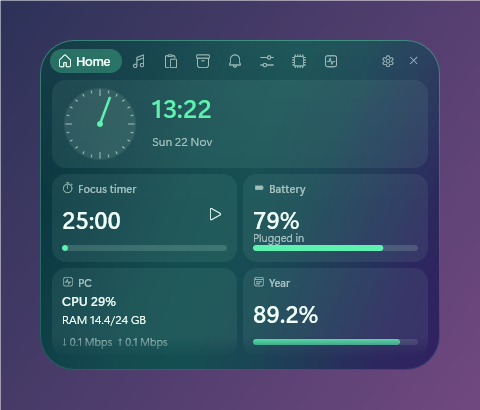
  &nbsp;&nbsp;
  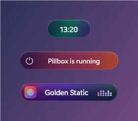

Left: the open card. Right: the closed pill as a clock, as a short notice, and as a tiny music player. Every screenshot uses demo data and a different theme.

**In short:**

- **One place for small things:** music with synced lyrics, clipboard history, a file shelf, reminders, volume and Wi-Fi/Bluetooth, PC stats, and your Claude Code sessions.
- **Stays out of the way:** it never takes keyboard focus, has no taskbar button, and hides itself when you play a game full screen.
- **Private by design:** everything stays on your PC. The internet is used only by features you switch on.

**Quick start:** [download the installer](#download-and-start-it-the-easy-way), run it, and rest the mouse on the pill at the top of the screen.

---

## Contents

1. [What you need](#what-you-need)
2. [Download and start it (the easy way)](#download-and-start-it-the-easy-way)
3. [Using Pillbox](#using-pillbox)
4. [A tour, tab by tab](#a-tour-tab-by-tab)
5. [Look and feel](#look-and-feel)
6. [Settings](#settings)
7. [Keyboard shortcuts](#keyboard-shortcuts)
8. [Privacy: what stays on your PC](#privacy-what-stays-on-your-pc)
9. [Good to know (limits)](#good-to-know-limits)
10. [Problems and answers](#problems-and-answers)
11. [Updating and removing it](#updating-and-removing-it)
12. [Licence and terms](#licence-and-terms)

---

## What you need

- **Windows 11**, or **Windows 10** version 1809 or newer (64-bit). It was built and tested on Windows 11; Windows 10 support is new and less tested.
- Nothing else for the easy way: no admin rights and no extra downloads.
- To build it yourself you also need Rust and the Visual Studio C++ Build Tools (see [Build it yourself](#build-it-yourself)).

## Download and start it (the easy way)

1. Open this page's **Releases** section (on the right of the repository page, or add `/releases` to the address).
2. Under the newest version, download **`Pillbox-Setup-<version>.exe`**.
3. Double-click it. Windows may show a blue **"Windows protected your PC"** screen, because the installer is not signed with a paid certificate. This is normal for a private app. Click **More info**, then **Run anyway**. You only do this once.
4. Follow the installer. It installs just for you (no administrator password) and offers to start Pillbox when you sign in to Windows (ticked by default).
5. Leave **Start Pillbox now** ticked and click **Finish**. A black pill slides in at the top centre of your screen and a small icon appears near the clock (click the little `^` arrow if it is hidden). That is Pillbox running.

Pillbox never opens a window of its own and has no taskbar button; it lives in that pill and in the tray icon.

**Start with Windows later (or stop it):** right-click the tray icon and tick or untick **Start with Windows**, or use the switch at the top of Settings > General.

---

## Using Pillbox

- **Open it:** rest the mouse pointer on the pill (or press **Ctrl+Alt+N**). It opens into a card with a row of icons on top, one per tab.
- **Close it:** move the mouse away, or press **Ctrl+Alt+N** again.
- **Switch tabs:** click an icon, or scroll the mouse wheel while the pointer is on the row of icons.
- **Settings:** the gear at the right end of the icon row, or the tray icon menu.
- **Quit:** the small **X** at the right end of the icon row (click it twice to confirm), or the tray menu.
- **Hide it for a while:** **Ctrl+Alt+H**, or the tray menu. Pillbox also gets out of the way by itself when you play a game full screen (you choose what it does then; see [Games](#games)).
- It never takes keyboard focus away from what you are typing in, and it only reacts when your pointer is actually on it. The corners of the card are click-through.

### The closed pill

The closed pill is not just a clock. It shows the time, or a tiny music player (title, a live equalizer, the cover colours), or a short notice: microphone muted, Caps Lock on, a call timer, a screenshot saved, a reminder ringing, a new notification.

---

## A tour, tab by tab

### Home: widgets

A grid of small tiles you choose in Settings: **clock**, **world clocks**, **day clock** (24-hour dial with sunrise and sunset), **weather**, **next reminders**, **sun and moon**, **to-do list**, **quick note**, **calculator**, **focus timer**, **countdown**, **day and year progress**, **battery**, **screen time**, **play time**, **PC stats**, **photos**, and (only if you switch online widgets on) ping, website status, currency rates and air quality.

Drag a widget out with its small corner button and it **pops out onto the desktop** as its own floating tile (right-click it to close).

**Weather.** With the *detailed* weather look (Settings > Home & widgets), **click the Weather tile to expand it**: today's temperatures from 6:00 to 21:00 appear as a small curve (the hour you are in is highlighted), and below them the next five days, each with the weekday, the weather, the high and low and the chance of rain.

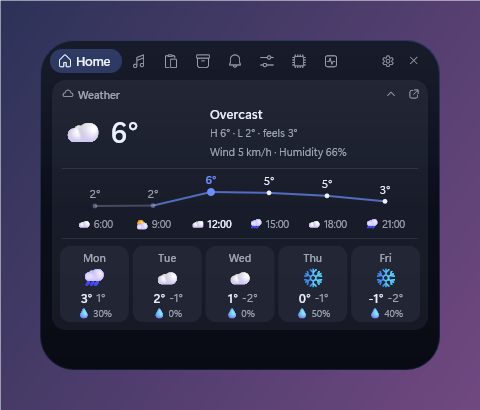

**Play time.** Time spent in *games* is counted per game and per day (the last 60 days, kept only on your PC). Well-known games such as Roblox, Minecraft, Fortnite, Valorant or THE FINALS count whenever they are the app in front, in a window too, and show under their real name. Other games count while they run full screen. **Click the Play time tile to expand it**: it shows a chip for each of the last 7 days and, for the day you pick, every game you played with how long and a bar to compare them. Only games are counted: browsers, video players, Steam and other launchers, Discord and similar are ignored.

  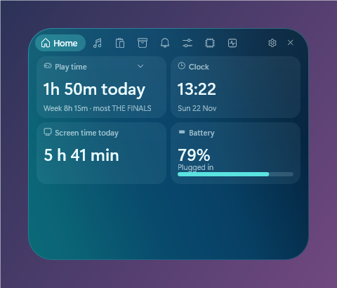
  &nbsp;
  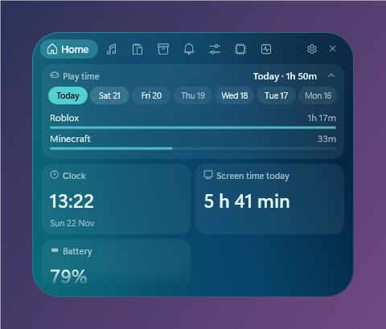

### Music

Shows what is playing in **any** player (Spotify, YouTube in a browser, VLC...): cover, title, artist, a progress bar you can click or drag, previous, play/pause, next. Five progress-bar looks (line, bar, dots, wave, segments) and a live equalizer in the pill.

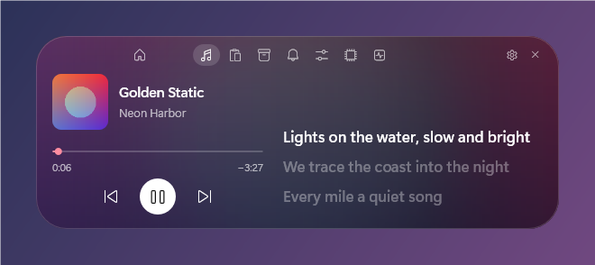

- **Synced lyrics** (Settings > Music, off by default): lyrics scroll in time with the song on the right of the card. Scroll the wheel over them to look around and press **Return to live** to come back; pauses in the song show as three dots. Lyrics come from the free LRCLIB service and are cached.
- The **colours** of the card and the closed pill follow the cover, and the card's background glow reacts to the bass, middle and treble of what you hear.

### Clipboard

A history of what you copied (text, links, pictures, files), searchable, with **pin**, **copy back**, **delete**, and **text from pictures** (it reads the words in a screenshot). Stored encrypted for your Windows account. Text snippets you save are one click away. Anything a password manager marks as secret is not recorded, you can list apps to ignore, and unpinned copies are **deleted after 2 days**. Pinned items and snippets stay.

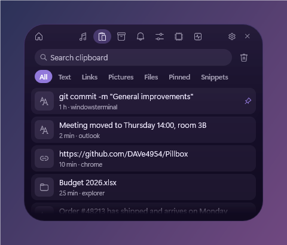

### Shelf

Drop files on the pill to keep them on a **shelf**, then drag them out into any other app later. New screenshots land here too. Right-click a file for more (open, open with..., show in folder, send to your phone, remove).

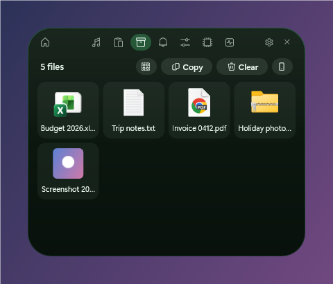

### Reminders

Type for example "call mum at 18:30", "in 10m tea", "tomorrow 15:00 dentist" or "weekdays 9:00 stand-up" and press Enter. Reminders ring on the pill with the Windows alarm sound; snooze or mark done right there.

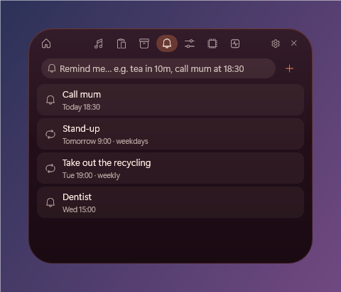

### Controls

- **Volume** (and mute) and **brightness** sliders (laptop screens and most external monitors).
- **Wi-Fi** and **Bluetooth** cards. The round switch turns the radio on or off. Click the rest of a card to **expand it** into a list:
  - *Wi-Fi:* networks in range with signal bars. Networks Windows already knows get a **Connect** button; the connected one gets **Disconnect**. A brand-new network with a password is joined in Windows' own Wi-Fi page ("More in Windows").
  - *Bluetooth:* your paired devices, each marked **Connected** or **Not connected**. Headphones, earbuds and speakers get **Connect** / **Disconnect** buttons. Mice, controllers and phones only show their state, because Windows reconnects those by itself.
- **Mic** mute for every app, **Sound** (opens Windows' sound page), a **Mirror** (your webcam, shown flipped like a mirror, for a quick look before a call), and an optional **Chat** drawer.
- A line with a timer and a **Mute** button while any app is using your microphone (a call).
- Six **launcher** slots: put your favourite apps there.

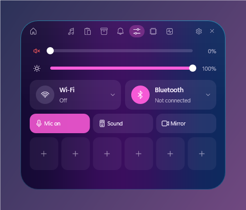

### System

One card each for **CPU**, **GPU**, **memory**, **disk activity**, **network speed** and **battery**. You can also open the same cards as a separate floating window from the tray menu.

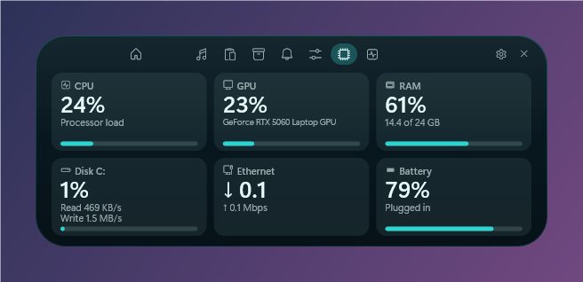

### Activity (coding assistants)

For people who use **Claude Code** or **Codex**: shows what each assistant is doing in each session (working, waiting for you, finished), your usage limits, and lets you **Allow** or **Deny** a permission question right on the pill. Connecting an assistant is explicit and never automatic: see the command-line helper in [docs/REFERENCE.md](docs/REFERENCE.md) (`pillboxctl hooks claude --apply`).

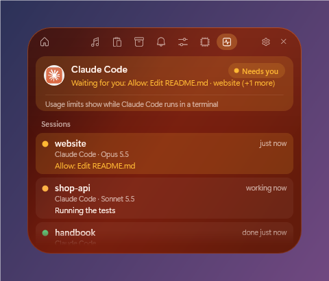

### Notifications

Mirrors the Windows notifications you receive (with each app's own icon) in a list, and shows the newest on the pill for a few seconds. Optional and off by default; Windows asks for permission the first time. Once switched on it gets its own tab.

### Games

When a game runs full screen Pillbox can **hide**, shrink into a thin **stats strip** (CPU, GPU, memory, network speeds, temperatures), or stay. It never takes the mouse from the game. You can set a different behaviour per program.

### Also

- **Phone transfer:** show a QR code, scan it with your phone and send photos or files to the PC (or download a shelf file to the phone) over your home network, no cloud and no app on the phone.
- **Screenshot** shortcut (saves to the shelf), **colour picker** shortcut (copies the colour under the pointer as a hex code), **lock-key notices** (Caps Lock, Num Lock) on the pill.
- **Hide until hover:** keep Pillbox completely out of sight until the pointer touches the screen edge, with rules for when music, notifications or reminders may peek out.

---

## Look and feel

You can change how Pillbox looks without touching any code: many **surfaces** (black, graphite, glass, soft colours), **colour schemes** for the pill and the card, a placement on the **top, left or right** edge, and a **size** from 80% to 140%.

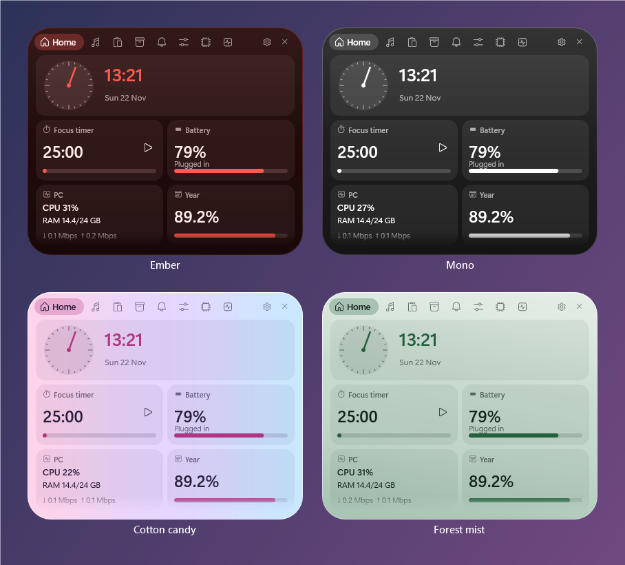

The same Home tab in Ember, Mono, Cotton candy and Forest mist.

The colour schemes come in two kinds. Seven are **one colour** (Midnight, Ocean, Forest, Sunset, Violet, Ember, Mono). Eight are **fades** of several colours: Aurora, Golden hour, Deep sea, Midnight neon, Forest mist, Lava, Mono fade and Cotton candy. Three of the fades **move gently**: Aurora and Lava drift slowly and Midnight neon shimmers now and then. They stand still when Pillbox is hidden, while a game is full screen, or when you switch **Animate backgrounds** off.

You can also make **your own fade** (Settings > Appearance > Your fade): pick two or three colours, where each one sits, the direction (across, down, diagonal or any angle), how softly they blend and how strongly they cover the surface. Pillbox picks light or dark text for it by itself, and if your colours would make text hard to read it shows them a little deeper or lighter so the text always stays readable.

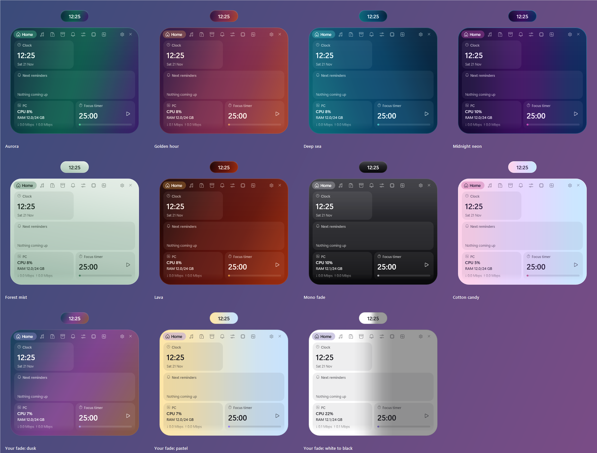

The eight fade themes, and three fades of your own (the last one, white to black, was toned down so its text stays readable).

## Settings

Open **Settings** from the gear (or the tray icon). It is a normal window with eleven pages and a **search box** at the top. Each page says in one line what it is for:

| Page | What is there |
|---|---|
| General | Start with Windows, where Pillbox sits and how big it is, hiding, opening |
| Closed pill | What the small pill shows: the clock (or date, weather, battery...), the playing song, the call timer, the microphone dot, notices. Every one can be switched off, and **Music before calls** keeps the song on the pill while an app such as Discord holds the microphone |
| Appearance | Colours, themes, fades and glass |
| Music | The song on the pill and the Music tab |
| Home & widgets | The Home tab's widgets, weather and the System window |
| Clipboard & Shelf | Clipboard history, snippets, the file shelf and your phone |
| Notifications & calls | Windows notifications, calls and the microphone, reminders |
| Games & Apps | What Pillbox does while you play, and rules for single apps |
| Agents | Claude Code, Codex and the chat drawer |
| Shortcuts | Keyboard shortcuts and the launcher |
| About | Version, licence, your data, and resetting |
 Every change is **saved automatically** a moment after you make it and Pillbox applies it at once. Nothing needs an OK button. **About > Reset all settings** puts everything back (your clipboard history, reminders and shelf are kept).

  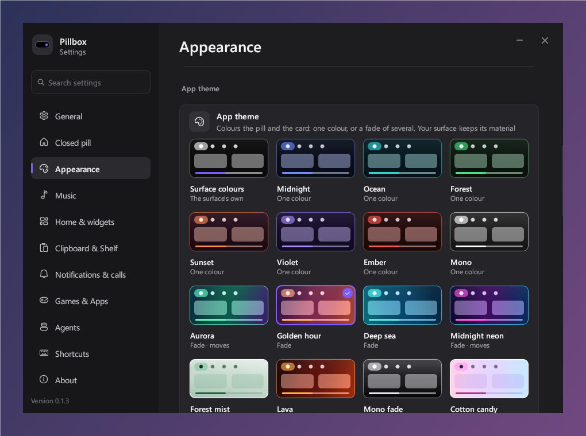
  &nbsp;
  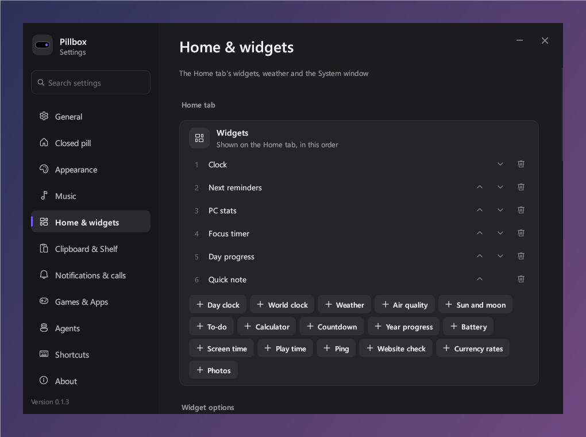

Settings are stored in the file `%APPDATA%\Pillbox\settings.json` (type that into the Explorer address bar). You can edit it by hand; Pillbox picks the change up immediately.

## Keyboard shortcuts

All can be changed or cleared in Settings > Shortcuts.

| Shortcut | What it does |
|---|---|
| Ctrl+Alt+N | Open / close the card |
| Ctrl+Alt+H | Hide / show Pillbox |
| Ctrl+Alt+P | Play / pause the music |
| Ctrl+Alt+Shift+M | Mute / unmute the microphone for every app |
| Ctrl+Alt+S | Screenshot (saved to the shelf) |
| Ctrl+Alt+C | Copy the colour under the pointer |
| Ctrl+Alt+Shift+T | Open / close the chat drawer (if switched on) |

## Privacy: what stays on your PC

Pillbox is built to keep everything local.

- **Nothing is collected, nothing is uploaded, there is no account and no analytics.**
- Your settings, clipboard history, reminders, shelf, notes and play time are files in `%APPDATA%\Pillbox`. The clipboard history is encrypted with your Windows login.
- The internet is used **only** by features you turn on:
  - *Weather* asks `open-meteo.com` for the weather at the place you pick (it sends that place's coordinates, nothing about you).
  - *Lyrics* send the song's title, artist and length to `lrclib.net`, once per song.
  - *Online widgets* (off by default) ping a host, ask for currency rates or air quality, or visit the websites you list.
  - The *chat drawer* (off by default) loads the Twitch or YouTube chat page you give it.
  - *Claude usage numbers* (off by default; Settings > Agents) read your own Claude sign-in file on your PC to ask Anthropic for your usage.
- *Phone transfer* and the command-line helper talk only inside your own network or on your own PC, with a random one-time token.
- Pillbox can optionally be **hidden from screenshots and screen recordings** (Settings).

The long technical notes on every one of these, including exactly how phone transfer is locked down, are in [docs/REFERENCE.md](docs/REFERENCE.md).

## Good to know (limits)

- **Windows 10 and 11.** On Windows 10 a few things look or work differently:
  - The icons use Windows 10's icon set and the text uses Segoe UI, so it looks slightly plainer.
  - The glass surfaces (Acrylic, Liquid glass, Candy glass) show a tinted fill instead of the live blur of what is behind the pill. Windows 10 would draw a yellow frame around the whole screen while capturing it, so Pillbox does not capture there.
  - The chat drawer needs the free Microsoft Edge WebView2 Runtime. Most Windows 10 PCs have it; the installer tells you if yours does not.
  - Windows notifications on the pill may not be allowed on every Windows 10 PC.
  - Windows versions before Windows 10 1809, and other systems, are not supported.
- **Not signed.** Windows shows a one-time "protected your PC" warning (see [Download](#download-and-start-it-the-easy-way)).
- **No automatic updates.** You replace the files yourself (see [Updating and removing it](#updating-and-removing-it)).
- **Full-screen games:** nothing can draw over a game that uses *exclusive* full screen. Pillbox then hides or shows its stats strip according to your setting; games in "borderless" or "windowed full screen" mode work best.
- **Bluetooth Connect / Disconnect** works for audio devices (headphones, earbuds, speakers). Other devices only show their state.
- **Wi-Fi list:** it uses Windows' own Wi-Fi interface and joins only networks Windows already knows. It has not been tried on every kind of Wi-Fi adapter.
- **Lyrics** come from a free community service and not every song is there.
- **Fades on glass:** on the glass surfaces you see the screen behind Pillbox through the fade, so the text colour is picked for an average background. Over a very bright or very dark window the text can be harder to read; a solid surface avoids that.

## Problems and answers

**"Windows protected your PC" when I start it.** Click *More info*, then *Run anyway*. The app is not signed with a paid certificate.

**I can't see the pill.** Look at the very top centre of the screen. If you set *Hide until hover*, move the mouse to the top edge. Check the tray icon (the `^` near the clock) and use **Show Pillbox** there. If it is still missing, quit it from the tray and start it again.

**Windows asks about the firewall.** Only when you use *Phone transfer* for the first time. Allow **Private networks** only. If nothing appears and the phone can't reach the page, see "Phone transfer and the Windows firewall" in [docs/REFERENCE.md](docs/REFERENCE.md).

**The Wi-Fi card says "No Wi-Fi adapter".** The PC has no Wi-Fi (a desktop on a cable, for example). Windows may also need **Location** switched on (Settings > Privacy & security > Location) before apps can list nearby Wi-Fi networks.

**Bluetooth "Connect" does nothing.** The device must be switched on and in range. Pillbox can only connect/disconnect audio devices (headphones, speakers); other devices show their state only.

**The lyrics are wrong or missing.** They come from a free community service and not every song is there. They can be switched off in Settings > Music.

**Where are my files?** `%APPDATA%\Pillbox` (settings, history, data) and `%LOCALAPPDATA%\Pillbox` (a log of the last run: `pillbox.log`, `settings.log`). The log never contains what you copied or what a notification said.

**Pillbox uses too much CPU / memory.** It normally uses about 0.02% of one core when idle. If you see much more, send the log. (The Bluetooth list refreshes every 4 seconds while it is open, so it costs a little more then.)

## Updating and removing it

- **Update:** download the newest `Pillbox-Setup-<version>.exe` from Releases and run it. It replaces the old version and keeps your settings.
- **Remove:** Windows **Settings > Apps > Installed apps > Pillbox > Uninstall**. This also removes the start-with-Windows entry. To erase every trace, also delete `%APPDATA%\Pillbox` and `%LOCALAPPDATA%\Pillbox`.
- If you used the name **Island** before (an earlier version), Pillbox copies your old settings and data over the first time it starts, and moves the *Start with Windows* entry to the new name. The old folder is left alone and can be deleted.

## Licence and terms

Pillbox is **free to use, but not open source**: you may download and use it for free, but not copy, change, sell or share its code or app outside this page. The full wording is in [LICENSE](LICENSE), and the [Terms of Use](TERMS.md) explain the no-warranty terms and what Pillbox sends where. The installer asks you to accept both.

Pillbox is built with open-source libraries, all under licences that allow free and commercial use; they and their licence texts are listed in [THIRD-PARTY-NOTICES.txt](THIRD-PARTY-NOTICES.txt). Weather data by [Open-Meteo.com](https://open-meteo.com) (CC BY 4.0).

Copyright (c) 2026 David Sejkora.
